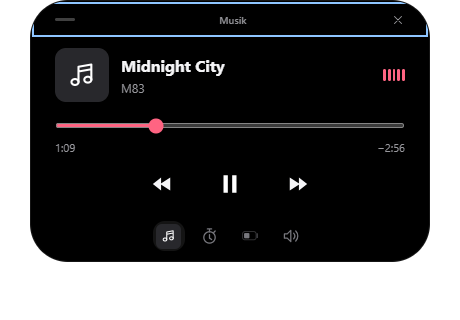
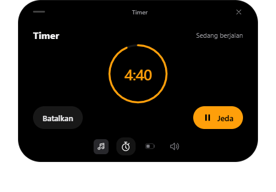

# Dynamic Island for Windows

Aktivitas sehari-hari dalam satu overlay kecil di desktop Windows. Pantau musik, volume, baterai, dan timer tanpa berpindah aplikasi.

## Screenshot

| Kontrol musik | Timer |
| --- | --- |
|  |  |

*Screenshot menggunakan data contoh dari pengujian UI.*

## Fitur

- Kontrol musik yang sedang diputar di Windows.
- Atur volume dan mute dengan cepat.
- Lihat status baterai dan pengisian daya.
- Buat, jeda, dan lanjutkan timer.
- Tampilan ringkas dengan hingga dua aktivitas sekaligus. Klik untuk membuka detail, tekan Escape untuk menutup.

## Instalasi

Untuk Windows 10 (2004 atau lebih baru) dan Windows 11, 64-bit.

Unduh installer atau ZIP dari [Releases](https://github.com/andika0x10/dynamic-island/releases). Jalankan installer, atau ekstrak seluruh ZIP lalu buka `Dynamic Island.exe`.

Mulai v0.2.0, installer sekitar **1,24 MB** dan ZIP sekitar **0,89 MB**. Aplikasi memakai WebView2 bersama milik Windows dan .NET Framework 4.8 yang tersedia pada versi Windows yang didukung. Jika WebView2 belum terpasang, installer memerlukan internet untuk mengunduhnya dari Microsoft. Untuk ZIP, pasang [WebView2 Runtime](https://developer.microsoft.com/microsoft-edge/webview2/) terlebih dahulu bila diperlukan. Folder aplikasi sekitar 3 MB, di luar runtime bersama dan cache WebView2.

Aplikasi belum ditandatangani, sehingga Windows dapat menampilkan SmartScreen. Gunakan ikon tray untuk menampilkan, menyembunyikan, atau keluar dari aplikasi.

## Menjalankan dari source

Siapkan Node.js 22.18+ atau 24+ dan .NET 10 SDK di Windows, lalu jalankan:

```sh
npm install
npm run dev
```

Panduan build, pengujian, dan rilis tersedia di [dokumentasi pengembangan](docs/DEVELOPMENT.md).
