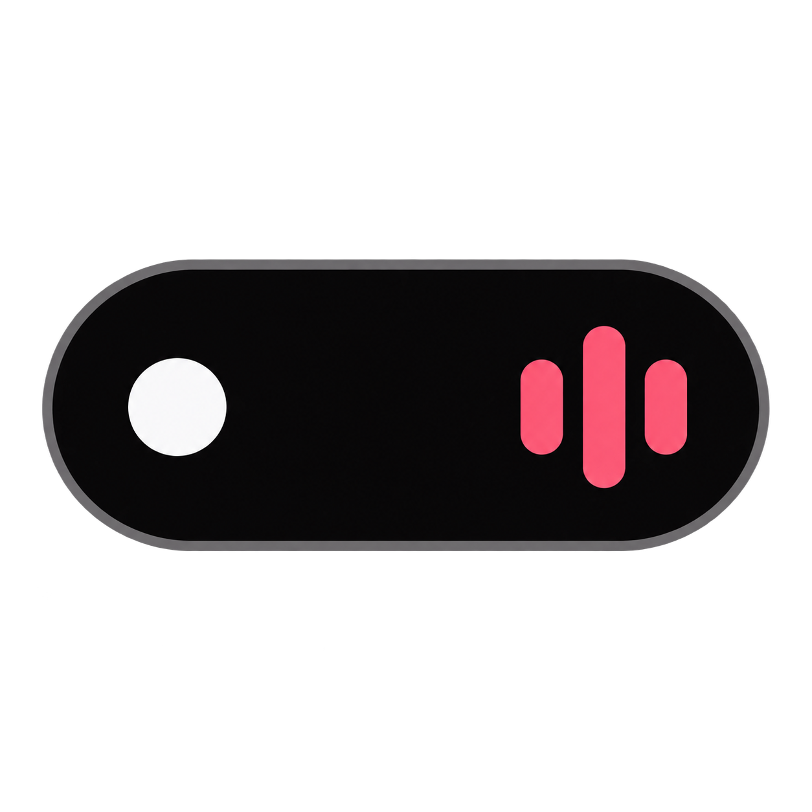
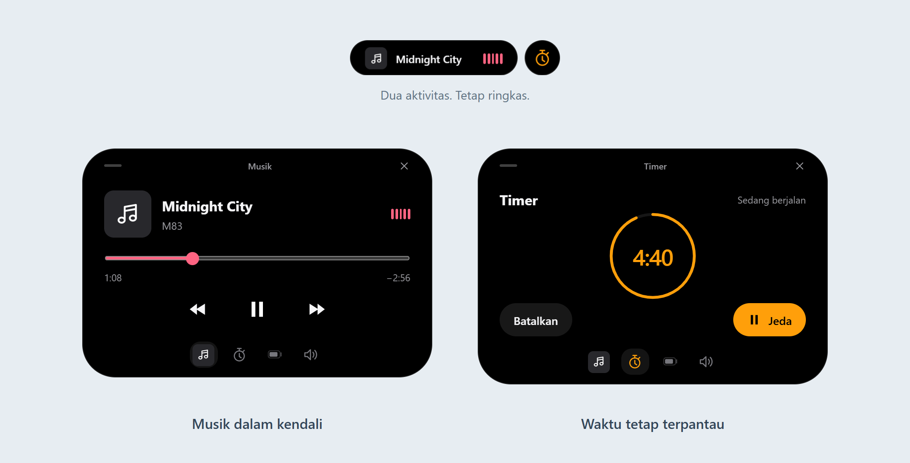

# Dynamic Island for Windows



Musik, timer, baterai, dan volume dalam satu overlay kecil di desktop.

[**Unduh untuk Windows**](https://github.com/andika0x10/dynamic-island/releases/latest) · [Panduan pengembangan](docs/DEVELOPMENT.md)



<sub>Tampilan aplikasi dengan data contoh. Klik island untuk membuka detail; tekan Escape untuk menutup.</sub>

## Yang bisa kamu lakukan

- **Musik & volume** — kontrol pemutaran, geser posisi lagu, atur volume, atau mute.
- **Timer** — mulai hitung mundur, jeda, dan lanjutkan saat dibutuhkan.
- **Baterai** — lihat sisa daya dan status pengisian tanpa membuka pengaturan.

Dua aktivitas bisa tampil bersamaan. Gunakan ikon tray untuk menampilkan, menyembunyikan, atau keluar dari aplikasi.

## Mulai pakai

Butuh **Windows 10 versi 2004+ atau Windows 11 (64-bit)**.

1. Pasang [WebView2 Runtime](https://developer.microsoft.com/microsoft-edge/webview2/) bila belum tersedia.
2. Unduh **MSIX** dari [rilis terbaru](https://github.com/andika0x10/dynamic-island/releases/latest), lalu buka dengan **App Installer** dan pilih **Install**.
3. Jalankan **Dynamic Island** dari Start Menu.

Aplikasi otomatis berjalan saat login Windows setelah instalasi, atau setelah ZIP pertama kali dijalankan. Untuk mematikannya, klik kanan ikon tray lalu nonaktifkan **Jalankan saat login Windows**. Pilihan ini tetap tersimpan saat aplikasi diperbarui. Simpan folder ZIP di lokasi tetap agar startup tetap berfungsi.

MSIX harus memiliki signature yang dipercaya Windows. Unduh `DynamicIsland.cer` dari rilis yang sama, lalu pasang ke **Local Machine → Trusted People** sebelum memasang MSIX self-signed. Langkah ini hanya perlu dilakukan sekali untuk sertifikat yang sama. Lihat [panduan MSIX dan signing](docs/DEVELOPMENT.md#msix-dan-signing).

## Jalankan dari source

Siapkan Node.js 22.18+ atau 24+ dan .NET 10 SDK di Windows.

```sh
npm install
npm run dev
```

Detail build, pengujian, dan rilis ada di [panduan pengembangan](docs/DEVELOPMENT.md).
